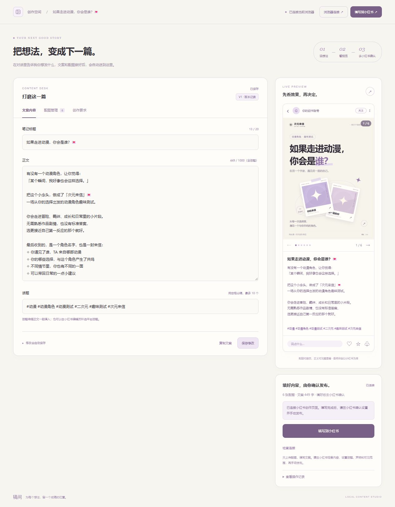
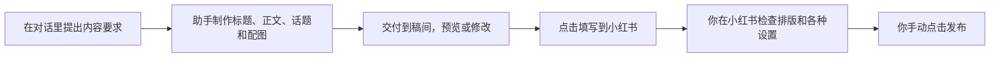

# 稿间 · 小红书内容工作台

把想法整理成一篇可预览、可修改的图文，再把配图与文案填入小红书。

**当前版本：0.4.0 · 只填写，由你在小红书确认并手动发布。** 工作台不会点击小红书的发布按钮，也不会自动选择原创声明、AI 声明、商品或可见范围。



## 它怎么用



工作台本身不包含独立的 AI 聊天模型。你可以在能访问本项目的助手对话中提出创作要求，助手通过交付命令把成稿送进工作台；也可以自己输入文案、上传图片。适用于生活记录、旅行、知识分享、产品介绍等不同主题。

## 功能

- 内容库：保存多篇笔记，按标题或主题搜索，查看待预览成稿。
- 编辑与预览：分别编辑文案、配图和创作要求；配图可排序、翻页、放大，正文可完整查看。
- 自动保存与版本记录：保留最近 20 个旧版本；恢复时创建新版本，原内容仍可回看。
- 对话交付：接收助手制作的成稿；遇到正在进行的手动编辑时保留编辑，并提示查看新版本。
- 浏览器连接：通过本地扩展使用你已经登录的 Edge 或 Chrome 创作页面。
- 自动填写：上传图片、填写标题和正文，核对后停止，交由你继续操作。
- 保留已有编辑：最新版扩展遇到另一篇笔记或无法确认的编辑内容时，使用新的编辑页，不清空原页。
- 奶油白与淡紫色界面；侧边栏可以收起，刷新后记住选择。

## 快速开始

### 1. 准备环境

推荐使用 **Windows 10/11、Node.js 22 或更新版本、最新版 Microsoft Edge**。

扩展使用 Manifest V3，也提供 Chrome 的加载方式；本项目当前的自动化验证主要在 Windows + Edge 上完成。

安装 [Node.js](https://nodejs.org/) 后，在终端确认：

```powershell
node --version
```

### 2. 下载并启动工作台

```powershell
git clone https://github.com/xiguajiushiwo/gaojian-studio.git
cd gaojian-studio
node server.mjs
```

打开 **http://127.0.0.1:4188/**。终端显示 `Rednote Publisher ready` 就表示服务已启动；使用期间保持该进程运行，结束使用时可在这个终端按 `Ctrl+C`。

**日常运行不需要先执行 `npm install`**：本地服务只使用 Node.js 内置模块。开发测试才需要安装开发依赖。

Windows 也可以双击项目中的 **`启动发布助手.cmd`**：它会检查已有服务、在需要时后台启动服务，并打开页面。不会创建桌面快捷方式，也不会设置开机自启。

新安装的内容库是空的。`examples/` 中附带一份图文示例，默认不会自动导入；你本机现有的草稿会继续保留。

### 3. 首次连接浏览器

1. 在工作台点击 **「浏览器连接」**，查看扩展文件夹路径和连接码。
2. 在你平时使用的小红书浏览器中打开 `edge://extensions/`，或 Chrome 的 `chrome://extensions/`。
3. 开启 **「开发人员模式」**，选择 **「加载解压缩的扩展程序」**，选中本项目的 **`extension/` 文件夹**。
4. 打开 [小红书创作服务平台](https://creator.xiaohongshu.com/)，自行完成扫码或短信登录。
5. 保持创作平台标签页为当前页，点击浏览器工具栏中的 **「来信发布台 · 小红书助手」**，输入工作台给出的连接码。
6. 回到工作台点击 **「检查连接」**，看到「已连接当前浏览器」即可。

扩展仍保留早期名称「来信发布台 · 小红书助手」，它连接的就是现在的「稿间」。连接码 10 分钟有效，用于本机工作台与扩展配对，**不是小红书短信验证码**。

### 4. 填写并手动发布

1. 在工作台选中笔记，检查标题、正文、话题和配图顺序。
2. 点击 **「填写到小红书」**。扩展会切换到创作平台，上传配图并填写文案。
3. 等待工作台提示 **「已填写，待你确认」**。此时笔记尚未发布。
4. 在小红书调整话题、原创声明、AI 内容声明、商品、位置、可见范围或定时等平台设置。
5. 最后由你在小红书点击 **「发布」**。是否发布成功、审核状态和公开展示情况，在小红书的笔记管理中查看。

你在小红书页面里做的修改和声明设置，**不会自动同步回工作台**。在那里完成调整后，请继续在同一编辑页确认并发布；如需重新从工作台填写，先保存好已有修改。

## 更新项目与重新加载扩展

```powershell
git pull --ff-only
```

| 更新内容 | 如何生效 |
| --- | --- |
| 页面样式、按钮或前端脚本 | 等自动保存完成后，刷新工作台页面 |
| `server.mjs`、`lib/` 等后台代码 | 停止原工作台服务，再运行 `node server.mjs` |
| `extension/` 中的扩展代码 | 到浏览器扩展管理页，对「来信发布台 · 小红书助手」点击一次「重新加载」 |

重载扩展后，回到工作台检查连接。已有配对通常会保留；若提示未连接，重新输入连接码。若创作平台标签页仍在使用旧版脚本，**先保存未发布的草稿，再刷新该创作页面**。

**关于 0.4.0：** 新版后台只派发填写和检查命令，旧的自动发布接口返回 `410`。所以后台升级完成后，即使扩展暂未重载，工作台也不会自动提交；重新加载扩展可启用新版填写校验和笔记识别逻辑。

## 在对话中交付成稿

这部分供能访问本机项目的助手或开发者使用。只是在普通聊天窗口发送文字，不会自动写入工作台；需要由助手执行下面的命令。更完整的协作约定见 [AGENTS.md](AGENTS.md)。

### 查看现有内容

先启动本地服务，然后在项目目录运行：

```powershell
node tools/deliver-note.mjs --list
node tools/deliver-note.mjs --get <draftId>
```

### 交付一篇新笔记

准备 `note.json`，以及对应的本地图片：

```json
{
  "title": "周末的城市散步",
  "body": "完整正文放在这里。\n\n不同段落之间可以留空行。",
  "tags": ["城市生活", "周末散步"],
  "imagePaths": ["cover.png", "page-02.png"],
  "category": "旅行",
  "brief": "写给想慢下来的人，语气轻松自然。",
  "deliveryNote": "完成两张配图，补充了散步路线和小建议。"
}
```

`imagePaths` 可以使用绝对路径，也可以相对于 `note.json` 所在文件夹。`tags` 不需要写 `#`。

```powershell
node tools/deliver-note.mjs note.json
```

命令会返回草稿 ID、版本号和预览链接。工作台会在没有待保存编辑时自动显示新稿；有编辑时会提示新版本到达。**交付只保存到本地，不会触发上传或发布。**

### 修改同一篇

修改前先执行 `--get <draftId>`，取得开始修改时的 `version`；在新 JSON 中带上：

```json
{
  "draftId": "现有草稿的 ID",
  "expectedVersion": 2,
  "title": "更新后的标题",
  "body": "更新后的完整正文",
  "tags": ["城市生活"],
  "images": ["从原稿读取的图片 ID"],
  "category": "旅行",
  "brief": "保留原来的创作要求",
  "deliveryNote": "按反馈调整了开头和结尾。"
}
```

保留旧配图时传原稿的 `images` 数组，不传 `imagePaths`。版本冲突表示用户或其他交付已经更新过内容，应重新读取、合并修改；不要直接换成最新版本号强行覆盖，也不要编辑运行中的 `data/library.json`。

## 支持范围与限制

| 项目 | 当前支持 |
| --- | --- |
| 内容类型 | 单篇图文笔记；支持管理多篇，逐篇填写 |
| 标题 | 最多 20 字，以工作台计数和平台实际校验为准 |
| 正文与话题 | 合计最多 1000 字 |
| 话题 | 最多 10 个，作为正文文字填入；平台话题可在官网补选 |
| 配图 | 最多 18 张 PNG / JPG / WebP，单张不超过 20 MB |
| 最后发布 | 由用户在小红书手动点击 |
| AI 创作 | 由外部助手对话完成，工作台不内置模型或 API Key |
| 不包含 | 视频、长文、自动勾选声明、自动提交、自动账号运营、批量定时发布 |

本项目通过浏览器页面操作实现填写，未接入小红书官方发布 API。登录验证由用户处理；平台页面变化可能需要更新选择器或改为手动填写。

## 数据存储与备份

- 草稿、旧版本、配图、本地配对信息和旧版提交记录保存在 **`data/`**。
- 侧边栏状态和最近选中的笔记保存在当前浏览器的本地存储中。
- 服务只监听 **`127.0.0.1:4188`**，不会默认开放到局域网或公网。
- 扩展使用现有登录状态完成页面操作，不读取或导出小红书账号密码、Cookie。
- `data/`、`work/`、浏览器测试资料、依赖、环境变量文件和日志均被 Git 忽略，不上传到仓库。

备份时先停止服务，再将完整 `data/` 文件夹复制到安全位置。恢复时也先停止服务；更换电脑或浏览器后可能需要重新配对。不要把包含配对信息的 `data/` 作为公开示例分享。

GitHub 用于保存和同步代码。**这个仓库不是一个可直接部署到 GitHub Pages 或 Cloudflare Pages 的静态站点**：本地 Node 服务负责草稿存储、图片读取和扩展连接，需要在使用电脑上运行。

## 常见问题

**工作台打不开？** 先运行 `node server.mjs`。地址中的 `127.0.0.1` 指当前电脑，服务关闭或换到另一台设备后，原地址不会自动运行。

**服务提示 `EADDRINUSE`？** `4188` 端口已经被占用。先检查已有工作台是否还在运行。扩展默认连接固定的 `4188` 端口，不要只改后台端口而忽略扩展配置。

**扩展没有连接？** 确认本地服务在运行、扩展已加载、小红书创作平台已登录；再检查连接码是否过期，是否连接了正确的浏览器标签页。

**填好之后为什么没有帖子？** 自动填写不会发布。请到小红书编辑页完成检查和设置，手动点击发布，再到笔记管理查看结果。

**重复填写会怎样？** 最新扩展能确认同一草稿且页面没有被修改时，可以复用已上传图片；不同草稿或无法确认的编辑内容会使用新编辑页。不要把原编辑页和新编辑页各发布一遍。

**在哪里改 AI 声明、原创声明、商品或定时？** 在小红书编辑页里设置。工作台不会替你作这些声明，也不判断内容是否符合平台原创资格。

**工作台为什么不显示手动发布结果？** 本版本没有同步小红书笔记管理。手动发布后的状态以小红书为准；工作台只保留已有的旧版提交记录。

## 开发与验证

```powershell
npm ci
npm test
```

测试需要本机安装 Edge。Playwright 是开发依赖，测试使用临时数据和模拟页面，不会向真实小红书发布笔记。主要覆盖：草稿与图片校验、版本冲突、交付命令、浏览器连接、断线恢复、只填写流程和旧发布接口拒绝。

验证记录见 [VALIDATION.md](VALIDATION.md)。

```text
gaojian-studio/
├─ public/                 工作台页面、样式与交互
├─ extension/              浏览器扩展
├─ lib/                    本地数据存储、扩展通信
├─ tools/deliver-note.mjs   对话成稿交付命令
├─ tests/                  自动化测试
├─ examples/               可选图文示例，不自动导入
├─ docs/images/            README 界面预览
├─ server.mjs              本地 HTTP 服务
├─ Start-Publisher.ps1      Windows 启动脚本
├─ 启动发布助手.cmd        Windows 双击入口
├─ AGENTS.md               助手协作约定
└─ data/                   本地数据，运行后生成，不提交
```
